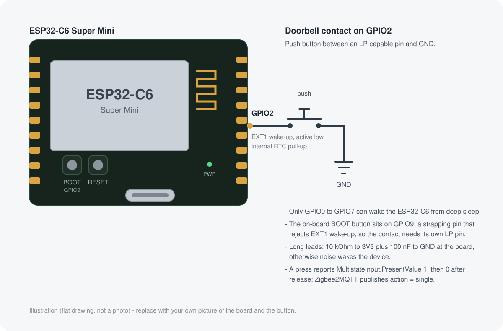

# esp32-c6-doorbell

A battery-powered Zigbee **doorbell button** on an ESP32-C6: it sleeps in deep
sleep at ~7 µA, wakes when the bell contact closes, reports the press to
Zigbee2MQTT / Home Assistant as `action: single`, and goes back to sleep.



*Illustration, not a photo — the ESP32-C6 Super Mini board and the doorbell
contact on GPIO2.*

## What it does

* **Deep sleep, not light sleep.** The chip is powered down to the datasheet's
  ~7 µA; every press is a cold boot that re-attaches to the Zigbee network and
  reports. Total awake time per press is about 1.4 s.
* **A button, not a switch.** No toggle commands, no switch entity. The device
  reports `MultistateInput.PresentValue` (`1` = contact closed, `0` = released) —
  the cluster ZCL defines for push buttons — and Zigbee2MQTT turns that into
  `action`, which Home Assistant exposes as a device trigger.
* **Nothing to configure on the radio side.** Network state lives in NVS, so the
  device rejoins by itself after each wake-up. No battery reporting, no OTA,
  no polling while asleep.
* **Bench-friendly:** a Kconfig self-test simulates presses, a GPIO probe finds
  the button pin, and the scripts in `scripts/` flash and capture a board that
  disappears from USB while it sleeps.

## Hardware

| Part | Note |
| --- | --- |
| ESP32-C6 Super Mini (ESP32-C6FH4, 4 MB flash) | any C6 board with an exposed LP pin works |
| Push button | between **GPIO2** and **GND**, internal RTC pull-up used |
| Power | USB for development; a battery/LiSoC for the real doorbell |

Only **GPIO0 … GPIO7** can wake the ESP32-C6 from deep sleep
(`SOC_GPIO_DEEP_SLEEP_WAKE_VALID_GPIO_MASK` in `soc_caps.h`). The on-board BOOT
button sits on GPIO9 — a strapping pin that even rejects EXT1 wake-up — so the
bell contact needs its own LP-capable pin. The pin is selectable in Kconfig
(`Doorbell firmware → GPIO of the doorbell push button`).

For a real doorbell lead, add an external **10 kΩ to 3V3 and 100 nF to GND** at
the board. EXT1 triggers on *level* low, so an unshielded cable otherwise turns
every glitch into a doorbell ring.

## Zigbee model

| Item | Value |
| --- | --- |
| Endpoint | 1, HA profile `0x0104`, device id `0x0006` *Remote Control* |
| Server clusters | Basic, Identify, Multistate Input (`0x0012`) |
| Signal | `MultistateInput.PresentValue`: `1` = pressed, `0` = released |
| Model / manufacturer | `C6-DOORBELL` / `DIY` |
| Zigbee2MQTT | external converter `z2m/esp32c6_doorbell.js` → `action: single` |

## Sleep model

* Deep sleep powers down CPU, radio and the digital domain; the RTC domain keeps
  a few words (`RTC_DATA_ATTR`) for the boot counter and undelivered presses.
* Wake-up sources: the contact (EXT1, active low) and optionally a maintenance
  timer (`Periodic keepalive wake-up`, default **off** — every timer wake costs a
  full boot and roughly triples the average draw).
* The press is reported *after* the stack re-attached to its parent, never
  before. If the network cannot be reached, the press stays queued in RTC memory
  and is delivered on the next wake-up (up to 5 presses).
* If the contact is still closed at sleep time, the chip sleeps on the timer
  only — an armed level-triggered wake-up with a held button would boot-loop.
* Deep sleep powers the USB PHY down, so the board **disappears from
  `/dev/ttyACM*` while asleep**. After a power-on reset the firmware therefore
  stays awake for 10 s (`Stay awake after power-on`), which is the window used
  for flashing and the serial console.
* Because deep sleep loses the parent link, the first press after a very long
  idle performs a rejoin first (one extra round trip, not user visible).

## Verified behaviour

One physical press on GPIO2, captured with a raw serial reader:

```
APP: boot #2 (wake cause 0x8: button), 1 press(es) queued, contact open
ZB:  network state restored from NVS, re-attached (PAN 0x4ec1, channel 11, short 0xe1eb)
APP: delivering 1 queued press(es)
ZB:  reported button state 1
ZB:  reported button state 0
APP: deep sleep until button press
```

→ `zigbee2mqtt/klingel/action` = `single`, ~1.4 s from press to sleep. Three
consecutive presses produced exactly three actions, no duplicates.

## Build and flash

```bash
. /opt/esp-idf/export.sh          # ESP-IDF v5.5.x
idf.py set-target esp32c6
idf.py build
```

`main/idf_component.yml` pulls `espressif/esp-zigbee-lib` (^2.0.5) from the
component registry on the first build.

Flashing a sleeping device needs a trick, because its USB port only exists for a
moment after power-on:

```bash
# power-cycles the hub port and catches the awake window with esptool in-process
python3 scripts/flash_when_awake.py --port /dev/ttyACM2 --hub 1-5 --hub-port 4

# serial output across deep-sleep cycles (raw fd: pyserial would reset the chip)
python3 scripts/serial_capture.py --port /dev/ttyACM2 --seconds 120 --out /tmp/boot.log
```

Both scripts assume a hub port that `uhubctl` can switch; with a plain USB cable
just replug and run `idf.py -p <port> flash` during the 10 s window.

## Prebuilt firmware

The build from this commit is attached to the
[release](https://github.com/Kalrkloss/esp32c6-doorbell/releases/latest):

| Asset | Purpose |
| --- | --- |
| `esp32c6-doorbell-merged.bin` | complete image (bootloader, partition table, app) — flash at `0x0` |
| `esp32c6-doorbell-app.bin` | application only — flash at `0x20000` |
| `SHA256SUMS` | checksums |

```bash
python -m esptool --chip esp32c6 -p /dev/ttyACM0 -b 460800 \
  --before default_reset --after hard_reset write_flash \
  --flash_mode dio --flash_freq 80m --flash_size 4MB \
  0x0 esp32c6-doorbell-merged.bin
```

The prebuilt image uses the Kconfig defaults, i.e. **button on GPIO2**. A
different pin needs a rebuild (`idf.py menuconfig` → `Doorbell firmware`).

## Pairing (Zigbee2MQTT)

1. Install the external converter — either copy `z2m/esp32c6_doorbell.js` to
   `<z2m>/data/external_converters/` or load it live, without a restart:

   ```bash
   python3 - <<'PY'
   import json, pathlib, subprocess
   code = pathlib.Path('z2m/esp32c6_doorbell.js').read_text()
   subprocess.run(['mosquitto_pub', '-t', 'zigbee2mqtt/bridge/request/converter/save',
                   '-m', json.dumps({'name': 'esp32c6_doorbell.js', 'code': code})], check=True)
   PY
   ```

2. Open permit-join, then power-cycle the board (a factory-new device steers in
   and stays awake for the interview):

   ```bash
   mosquitto_pub -t zigbee2mqtt/bridge/request/permit_join -m '{"value":true,"time":254}'
   ```

3. The device shows up as `DIY C6-DOORBELL` with an `action` expose. Every press
   publishes `zigbee2mqtt/<name>/action` = `single`, and Home Assistant gets a
   device trigger:

   ```yaml
   trigger:
     - platform: device
       domain: mqtt
       device_id: <doorbell>
       type: action
       subtype: single
   ```

## Kconfig knobs (`Doorbell firmware`)

| Option | Default | Purpose |
| --- | --- | --- |
| `DOORBELL_BUTTON_GPIO` | 2 | LP pin of the contact (0…7) |
| `DOORBELL_ED_TIMEOUT` | 6 (64 min) | how long the parent keeps the child record |
| `DOORBELL_KEEPALIVE_MS` | 1000 | poll interval while awake |
| `DOORBELL_JOIN_AWAKE_S` | 120 | stay awake after the first join (interview) |
| `DOORBELL_KEEPALIVE_WAKE_S` | 0 (off) | periodic re-attach instead of press-only |
| `DOORBELL_BOOT_AWAKE_S` | 10 | power-on window for flashing / serial |
| `DOORBELL_GPIO_PROBE` | n | log GPIO0…GPIO10 to find the button pin |
| `DOORBELL_SELFTEST` | n | count every boot as a press (bench test) |

## Gotchas this project paid for

* `esp_sleep_get_wakeup_causes()` returns `BIT(ESP_SLEEP_WAKEUP_UNDEFINED)`
  (value `0x1`, not `0`) after a power-on/USB reset. Testing `== 0` never
  matches, so a "power-on only" branch silently never runs.
* A pyserial reader **resets** the ESP32-C6 USB-Serial-JTAG bridge when it opens
  the port (DTR+RTS is the reset sequence). A real button press then looks like
  a power-on reset and is lost. `serial_capture.py` uses a raw file descriptor
  for that reason.
* ZCL reports carry a *change*: the device must report `0` after the press, or
  the next press reports nothing.
* A self-built end device has no binding and no ConfigureReporting record, so
  reports must be sent to an explicit destination (`0x0000`, endpoint 1).

## Repository layout

```
main/app_main.cpp            boot, wake-cause handling, press delivery, deep sleep
main/doorbell_device.cpp     Zigbee endpoint, clusters, report path
main/doorbell_button.cpp     GPIO contact + RTC pull-up
main/gpio_probe.cpp          bring-up helper: log GPIO levels
main/Kconfig.projbuild       all configuration
z2m/esp32c6_doorbell.js      Zigbee2MQTT external converter
scripts/flash_when_awake.py  flash a device that is asleep most of the time
scripts/serial_capture.py    serial capture across sleep cycles
docs/board-and-button.svg    wiring illustration
```

## Power budget

| State | Current |
| --- | --- |
| Deep sleep | ~7 µA (ESP32-C6 datasheet, low-power modes) |
| Press → report → sleep | tens of mA for ~1.4 s |

Presses only: a 2000 mAh cell is dominated by the idle current (~1.2 mAh/day).
Each hourly keepalive wake would add roughly 6 mAh/day, which is why it is off.

The board is currently fed from a USB hub, so no inline current measurement was
possible; the figures are the datasheet values for the blocks this firmware
switches off.

## License

MIT — see [LICENSE](LICENSE).
